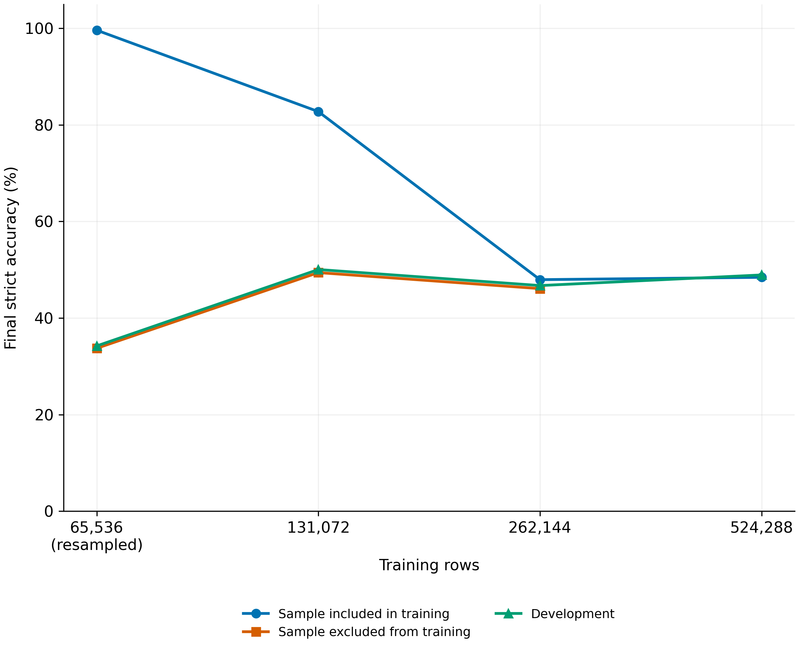

# Memorization and incomplete fitting in a recursive arithmetic reasoner rebuilt from its published description

This release contains the code, arithmetic datasets, saved predictions, evaluation records, and table calculations for twelve exploratory training runs. The model reconstructs missing operators in arithmetic expressions. Small training files were nearly memorized; larger files remained incompletely fitted within the tested budgets. The comparisons use one training seed, 101. The motivating paper's code was not used; the implementation follows its published description.

Repository v1.1.0 adds two fresh-batch single-pass controls, `S65f` and `S524f`, with seed 101 and the same forward execution as the earlier single-pass settings. Each performs 196,608 optimizer updates at batch 1,024, drawing a newly shuffled-epoch batch for every update. The archive extension contains their complete compact sampling records and final/best per-row predictions. The earlier dataset DOI below identifies version 1.0.1; it does not identify this new version. No new DOI is asserted in this snapshot.

Strict accuracy requires the complete canonical operator tuple, the chosen ordered list of operators. Semantic accuracy instead accepts any valid tuple producing the supplied result. Development rows are held-out examples reused for configuration choices and repeated evaluation; the development set contains 2,048 in-distribution (ID) rows. Out-of-distribution (OOD) rows combine a separate multiset bucket with larger target values. Multisets retain operand values and multiplicities while ignoring order.

| Measurement | Result |
| --- | --- |
| Sampled training-file fit, 65,536-row recursive / single-pass settings | 99.80% / 99.85% strict accuracy |
| Final sampled rows included / excluded from the nested training subsets | 99.60% / 33.74% at 65,536 rows; 82.75% / 49.41% at 131,072; 47.95% / 46.09% at 262,144 |
| Recorded final development, eight-step batch 4,096 / batch 1,024 settings | 1,361 / 1,002 correct rows, out of 2,048; 66.46% / 48.93% |
| Longest schedule, recorded final / largest observed development | 1,282 / 1,308 correct rows, out of 2,048 |
| Study's prespecified development threshold | 1,844 correct rows out of 2,048, the integer threshold for 90% |
| Eight retained final models, fresh-ID deficits relative to CPU development rescoring | 2.83–4.93 percentage points; 0.70–1.71 after reweighting fresh rows to the development operand-count mixture |
| Final fresh-OOD strict accuracy at each model's training recurrence count | At most 3.32% |
| Inclusive allocation charge | 238.52 GPU-hours across twelve settings; at most 82.01 per setting |
| Fresh-batch single-pass recorded final / best development, 65,536 rows | 237 / 284 correct of 2,048; selected best at update 77,824 |
| Fresh-batch single-pass recorded final / best development, 524,288 rows | 966 / 976 correct of 2,048; selected best at update 153,600 |
| Fresh-batch final CPU fresh ID, 65,536 / 524,288 rows | 357 / 1,804 correct of 4,096; 8.72% / 44.04% |

A GPU-hour measures one hour of allocated GPU time. Charge includes failed and inherited allocations. The recorded development endpoints and separately executed CPU rescoring are different measurements; tables retain both. Live-training windows pool row participations on changing training weights and held state, while checkpoint fitting evaluates sampled rows using averaged weights and reset state. Updates, batch sizes, recurrence counts, and schedule clocks differ across some comparisons. These comparisons describe configuration packages.

Setting names encode training cardinality, batch, depth, and schedule. `R` denotes recursive and `S` single-pass execution. `R65-original` is the original 65,536-row file, and `R65-resampled`, `R131`, and `R262` are nested subsets of the expanded 524,288-row file. `R524` uses batch 1,024 and eight steps. Larger-batch names explicitly give `B4096`, `D8` or `D16`, and short or long schedules. The earlier single-pass settings `S65` and `S524` retain eight-update batch holding. The suffix `f` denotes one update per newly drawn batch. A new draw is a slice of a shuffled epoch; the same training rows recur in later epochs. The fresh controls each draw 201,326,592 row slots, eight times the 25,165,824 in the earlier held-eight controls; they span 3,072 and 384 epochs. Warmup and learning-rate decay remain on optimizer-update clocks. These are comparisons of complete training configurations, with different exposure and schedule clocks per fresh draw. The per-setting options and calibrated schedules are in `configs/`.

## Reproduce

The record analysis uses Python 3.10's standard library. Figure rendering additionally uses matplotlib. No model library is imported by the analysis. From the repository root, the smallest check is:

```bash
python3 -B analysis/smoke.py
```

It verifies all four included dataset hashes and executes eight canonical arithmetic rows. The full dataset and prediction payloads are provided as archive parts alongside this release. Reassemble them using the archive README. Then use the offline importer, which verifies archive hashes, every prediction hash, and all decompressed dataset hashes:

```bash
python3 -B data/fetch.py --archive-dir ../reassembled
python3 -B analysis/verify.py
python3 -B analysis/rebuild.py --output rebuilt
python3 -B analysis/check_tables.py tables rebuilt
```

`check_tables.py` requires identical file inventories and compares every CSV cell as an exact string, including float representations and empty strata. The rebuild independently executes predicted operators, checks canonical row identities, recomputes stratum counts and Wilson intervals, reconstructs all 245 live windows, and derives the displayed supplement tables. It does not read expected table cells. Table layout files contain selectors and documentary locators; measurement answer cells are computed. Method comparison, cited source results, source classes, and readout coverage are transcribed documentary records. Internal decision chronology is excluded from this public package.

The previously published archive, version 1.0.1, remains at https://zenodo.org/records/23880859. For version 1.1.0, follow the archive extension README to combine its unchanged inherited parts and the changed-file overlay before running the offline importer. The importer accepts a local directory containing both generations of parts:

```bash
python3 -B data/fetch.py --parts-dir ../downloaded-parts
```

The importer verifies part lengths and SHA256, then complete compressed and decompressed payloads. `--online` fetches the six unchanged inherited payloads from v1.0.1; the new predictions are already included in this source snapshot and the archive overlay. Use `--base-url` for the new record after publication. The new-version DOI and URL must come from that deposition, not from the earlier version. Offline reproduction uses no network.

The seven `fresh_batch_*.csv` tables also regenerate without the inherited large payloads:

```bash
python3 -B analysis/fresh_tables.py --output fresh-rebuilt
```

This checks all 61,104 directly scored checkpoint-row pairs, reconstructs 52 score sets including empty membership subsets, and reports row-level Wilson intervals and signed fresh-ID-minus-development gaps. Membership labels retain the full-training-file scan receipt; the generic rebuild checks membership again against the full imported training files. Recorded bfloat16 GPU development counts and float32 CPU rescoring remain separate. In particular, the S65f final CPU strict count is 236 versus 237 recorded; the S524f best CPU count is 981 versus 976 recorded. Row intervals describe example variation, not training-seed uncertainty.

The eight existing figure files cover the earlier ten settings. The fresh-control curves and endpoints are provided in regenerated CSVs. To redraw the existing figure layouts from table CSVs:

```bash
OMP_NUM_THREADS=1 OPENBLAS_NUM_THREADS=1 MKL_NUM_THREADS=1 python3 -B analysis/figures.py --tables rebuilt --output redrawn
```

`src/reasoning/` contains the generator, model, optimizer, and base training implementation. `src/qdriver/` contains accumulation, single-pass, evaluation, and resumable execution code. Double-precision accumulation and checkpoint fixtures are in `src/tests/`. Training and these fixtures require a separately provisioned compatible PyTorch environment. Version 1.1.0 executes the shipped CPU suites on PyTorch 2.9.1+cu126 with CUDA hidden; this validates the current adapted files separately from the historical reports. The historical precision reports and negative controls are in `records/fixtures/`.

The model fixtures shipped in `src/tests/` are adaptations of the suites whose historical reports are included, written against later source versions than the earlier reports bind. Those historical reports do not attest execution of the shipped adapted bytes. The `test_provenance` section of [TRANSFORMATIONS.json](TRANSFORMATIONS.json) lists every historical source hash from the shipped suite reports that has no exact byte copy in this repository, with its historical relative filename and report locations; adaptation-source hashes remain in the per-file entries. `test_workload.py` was added for v1.0.1 and is a separate standard-library schedule check. No historical model fixture was rerun for v1.0.2. For v1.1.0, the current accumulation, checkpoint, equivalence, schedule and fresh-record suites are executed from the release archive. Small fixtures use eight included original-training sample rows and eight development rows, so they need no full training payload.

In such an environment, source entry points include:

```bash
PYTHONPATH=src CUDA_VISIBLE_DEVICES="" FIXTURE_OUTPUT=fixture-output python3 -B -m unittest tests.test_workload tests.test_fresh_record tests.test_c2_accumulation tests.test_checkpoint tests.test_equivalence
PYTHONPATH=src python3 -B src/train.py --config configs/R65-original.json --output outputs/example --device cpu
```

The fresh sampling verifier requires exactly PyTorch 2.9.1+cu126, the recorded permutation implementation, and uses no training examples or checkpoints:

```bash
PYTHONPATH=src CUDA_VISIBLE_DEVICES="" python3 -B src/verify_fresh_record.py records/S65f/curve
PYTHONPATH=src CUDA_VISIBLE_DEVICES="" python3 -B src/verify_fresh_record.py records/S524f/curve
```

Both complete records have 196,608 batch commitments and respectively 3,072 / 384 epoch commitments. `samples.jsonl` stores ordered-index SHA256 values, `epochs.jsonl` stores full-permutation and generator-state commitments, and `FRESH_RECORD.json` freezes seed, shape and original identities. `verification.json` binds the released record bytes. The verifier checks every regenerated commitment and rejects wrong, missing, torn or trailing records and a different Torch version. These commitments verify the sampling record; they do not independently prove optimizer execution. Original config, manifest, input and source hashes refer to the unchanged source collection, while `TRANSFORMATIONS.json` and `SHA256SUMS` bind the public adaptations.

Create `fixture-output` before running the fixtures. The training command describes a full training configuration and is computationally expensive. The archive contains no model weights. Configured data hashes and complete execution records support analysis from predictions without retraining. Frozen hashing namespaces in the source preserve the exact original split and stochastic draws.

`TRANSFORMATIONS.json` records source hashes, released hashes, and exact transformation rules for adaptations and generated artifacts. Source paths use neutral aliases. Checkpoint retention columns describe the source collection at paper preparation time; no checkpoint payload is distributed. `SHA256SUMS` binds the repository files. `data/archive_manifest.json` binds the additional payloads.

[records/allocations/INDEX.md](records/allocations/INDEX.md) identifies every allocation record and its recorded charge, including the preliminary roots charged to R524, R524-B4096-D16-short and R262. The device inventory distinguishes occurrences in the full project run records (not all released) from reproducible released-record counts. `analysis/verify.py` excludes the inventory itself, scans plain and decompressed gzip records, and checks every recorded UUID against the four listed devices.

## Data and citation

GitHub repository: https://github.com/wwhite777/recursive-arithmetic-memorization

Published Zenodo dataset, version 1.0.1: https://zenodo.org/records/23880859. DOI: https://doi.org/10.5281/zenodo.23880859.

Jeong, W., & Oh, H. (2026). Memorization and incomplete fitting in a recursive arithmetic reasoner rebuilt from its published description: data, predictions and reproducible analysis (Version 1.0.1) [Data set]. Zenodo. https://doi.org/10.5281/zenodo.23880859

Repository software: Jeong, W., & Oh, H. (2026). Memorization and incomplete fitting in a recursive arithmetic reasoner rebuilt from its published description (Version 1.1.0) [Software]. https://github.com/wwhite777/recursive-arithmetic-memorization

`CITATION.cff` identifies repository software version 1.1.0 and gives the published dataset version 1.0.1 as the preferred citation and a reference, with both authors' ORCIDs. The dataset DOI identifies the archived dataset version, not repository version 1.1.0.

## Third-party notices

Upstream revisions, attribution and scope of use are in [third_party/NOTICE.md](third_party/NOTICE.md). The original [Adam-atan2 MIT](third_party/ADAM_ATAN2_LICENSE), [HRM Apache 2.0](third_party/HRM_APACHE_LICENSE) and [TRM MIT](third_party/TRM_MIT_LICENSE) notices are included there.

## Limitations

These are exploratory single-seed measurements because configuration choices followed earlier seed-101 observations. Variation across training seeds remains unresolved. Development maxima select among repeated evaluations. New evaluation populations were frozen before scoring, after development results had informed the experimental choices. The untouched-ID subset has a different operand-count mixture, so pooled comparisons require care.

The implementation differs from the published description in data generation, canonical labels, fixed recurrence counts, gradient truncation, and other documented choices. It does not reproduce the original authors' code. Batch, schedule, updates, and exposure are not all controlled in the larger-batch comparisons. The planned backward-policy comparison was not run; these results establish neither backward-policy efficacy nor diagnostics for selecting such policies.

The original small-file and expanded-file baseline final weights were deleted for storage limits before the fresh sets existed, so their fresh scores are unavailable. The longest schedule's selected-best checkpoint was not retained, with no located deletion record. Historical numerical fixtures cover accumulation and resume behavior; a numerical derivative-suffix result report was not located. Source inspection does not supply that missing result. Row-level intervals and the post hoc operand standardization do not estimate training-seed uncertainty.

Copyright (c) 2026 Woncheol Jeong. MIT license; see `LICENSE`. Authors: Woncheol Jeong (ORCID 0000-0001-9484-7808) and Hayoung Oh (ORCID 0000-0002-7362-5138).
